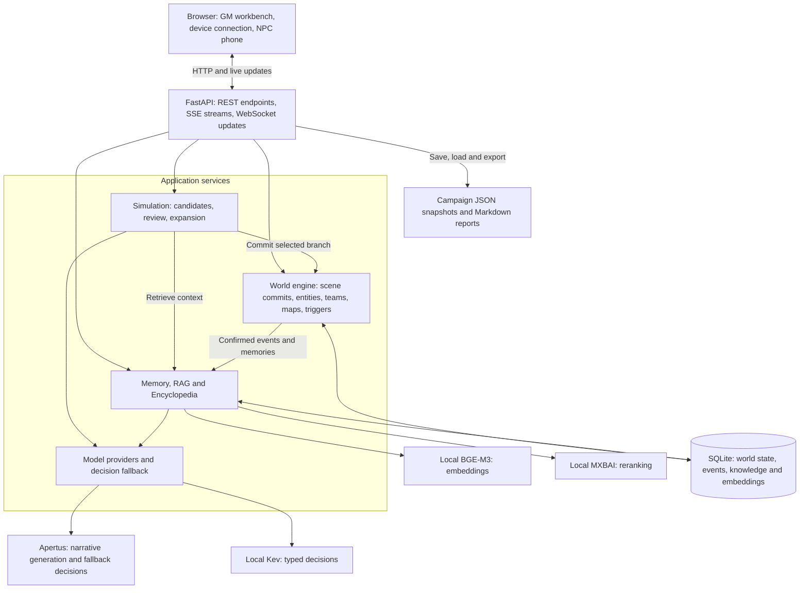

# Apertus Mundus - Track 2b

A persistent narrative roleplaying workbench built with Apertus. A game master can
explore candidate outcomes, expand a selected branch, and commit changes to a shared
world with teams, maps, character identities, scoped knowledge and versioned saves.

Team: Apertus Mundus.

## WHY APERTUS MUNDUS

Inspired by the Apertus open model, Apertus Mundus aims to make AI-driven
roleplaying a persistent world that a game master can run and shape. Player
choices have consequences beyond the next paragraph: characters remember events,
teams occupy real locations, and rules connect narrative decisions to world state.

The workbench brings scene authoring, branching simulation and session management
together. The GM explores possible outcomes and chooses what becomes part of the
story; confirmed changes carry forward through entities, maps, knowledge and saves.

The UI design draws inspiration from the
[official Hack Apertus website](https://hackapertus.ch/). Navy navigation, ivory
reading surfaces and red action accents bring technical clarity to a workbench
with the character of a narrative atlas.

## 💡 What It Can Do

- **Branching AI simulation:** Turn a player action into 2–4 candidate outcomes.
  Stream the selected branch's full narrative, then commit its HP/SAN, inventory,
  entity and map changes after preparation and expansion succeed.
- **Apertus generation and configurable decisions:** Use Apertus for narrative
  generation and NPC dialogue. Configure a separate decision provider and its
  fallback path in Model Settings, including smaller Apertus or local Kev decisions
  backed by the main Apertus service.
- **Three-level memory:** Combine a short-term workspace of up to 10 recent records
  within a context budget, entity profiles and memories, and retrievable long-term
  memory. Older working records are archived with summaries and their source text.
- **RAG and Encyclopedia:** Import worldbuilding and rule material, retrieve
  relevant passages during simulation, and maintain Encyclopedia entries with
  source revisions. Knowledge can be public, GM-only or scoped to a party.
- **NPC emotions and Persona:** Track trust, fear and irritation, configure
  breakpoint reactions, and give NPCs personality types, quirks and memories that
  inform their responses and conversations.
- **Spatial maps:** Connect rooms and passages to scenes, track party and entity
  locations, and use spatial context during simulation. Selected branches can
  discover or create locations and apply validated movement.
- **Triggers:** Combine `scene`, `item`, `stat` and `ai` conditions with `hard`
  navigation, `soft` prompts or `passive` effects to orchestrate story events.
- **Multiple team timelines:** Run parties in one shared world with separate
  scenes, locations and scoped memories, then merge timelines when their stories
  reconnect.
- **Further investigation:** Stream additional detail about the current scene
  through Investigate Further and retain it in the scene history used for reports.
- **Live updates and device access:** Push scene, investigation and BGM state over
  WebSocket, pair devices through the connection page, and synchronize saved world
  changes. The separate `phone.html` interface presents NPC contacts and dialogue
  as phone conversations.
- **Versioned saves and session reports:** Save world snapshots with characters,
  timelines, maps, memories, knowledge and existing embeddings. Generate incremental
  narrative reports from recorded scenes and download them as Markdown.

## Project Architecture

Apertus Mundus is a Vue browser workbench served by a modular FastAPI application.
SQLite holds the shared world's state; model services handle generation, typed
decisions, embeddings and reranking. The diagram shows the logical components of
the default Docker deployment.



### Components and Data Flow

- **Browser interface:** `index.html` and its frontend modules provide the Vue GM
  workbench. `connect.html` handles device access, and `phone.html` provides NPC
  conversations. REST carries commands, SSE streams generated text, WebSocket
  broadcasts player state, and revision polling refreshes connected workbenches.
- **Simulation and world engine:** `main.py` mounts the API modules.
  `agent_operations.py` generates candidate summaries; `selected_branches.py`
  prepares the chosen candidate with NPC and spatial checks. After prose expansion,
  `scene_service.py` and `engine.py` validate and commit the scene and its effects
  in a SQLite transaction. Entities, teams, maps and triggers share this world.
- **Memory and knowledge:** `memory_service.py` manages working and archived
  memories. `knowledge.py`, `rag.py` and `reranking.py` retrieve scoped context;
  the Encyclopedia API and Wiki compiler maintain source revisions and derived
  pages. Knowledge and existing embedding vectors are stored in SQLite.
- **Model services:** `providers.py` connects to the configured Apertus endpoint
  and routes typed decisions through the selected provider and fallback chain.
  Docker Compose runs BGE-M3, MXBAI Rerank Base v2 and Kev as local helper services.
  The optional local deployment also serves Apertus on an NVIDIA GPU.
- **Persistence:** `database.py` provides shared SQLite transactions, while
  `campaigns.py` saves and restores versioned world snapshots. In Docker, the
  database, campaigns, settings and reports live under `/app/runtime` in the
  persistent `app-data` volume.

A player action first gathers scene, entity, map and permitted knowledge context.
The model returns candidate summaries, which remain drafts. Selecting one triggers
preparation and any required review, followed by streamed narrative expansion.
The commit then applies the validated world effects and records the event; memory
maintenance and knowledge compilation run after confirmed changes.

### Repository Layout

```text
track_2b/
├── src/                  # Browser UI, FastAPI modules and application scripts
├── data/                 # Bundled demo, example campaigns and knowledge sources
├── helpers/              # Local embedding, reranking and decision model services
├── docs/                 # Deployment, validation and report-generation material
├── tests/                # Backend and frontend regressions
├── compose.yaml          # Application and local helper service deployment
├── compose.local.yaml    # Optional local Apertus GPU deployment
├── Dockerfile            # Application image
└── Makefile              # Run, smoke-check and packaging commands
```

## ✨ How to Use

### 1. Load a Campaign

Start the application using the [quick start instructions](#quick-start), then open
http://localhost:8000/index.html. Choose an entry under **Campaigns and Saves** and
click **Load Campaign and Start**. **Model Settings** lets you configure and test
the saved generation, decision and retrieval connections.

The included examples provide different starting points:

- **Mist Harbor Lighthouse - Public Demo:** A fictional lighthouse investigation.
- **Blank Campaign:** An opening scene for authoring your own world.
- **Limmat — The Forbidden River:** A hidden-world student adventure in Zurich
  with two teams, authored rules, maps and reference material.

Use these as demonstrations or starting points for your own campaigns.

### 2. Run a Simulation

Select a scene from **Scene Directory** or **Node Graph**. Under **Player Actions &
Dynamic Simulation**, describe the player's action and click **Run Simulation**.
The AI generates 2–4 candidate summaries whose proposed consequences can include
HP/SAN changes, items gained or lost, movement, and new characters or entities.

Choose a branch to continue. The workbench prepares that candidate, asks for NPC
review when needed, and streams its expanded narrative. After expansion succeeds,
it commits the selected scene and its world changes together. Generating candidate
summaries alone does not apply their proposed consequences. If a request needs
clarification, resolve it before continuing.

### 3. Manage World Resources

Use the workbench's task groups to keep the session and its reference material
connected:

- **Session Host:** Open **Timeline** to create parties, assign their scenes and
  members, run independent simulations, inspect their memories or merge timelines.
  Open **Map** to edit rooms and passages and inspect party and entity positions.
- **World Information:** Use **Entities** for the world entity registry,
  **Encyclopedia** for source material and compiled knowledge, **Memory Stream**
  for session history, and **World Settings** for the campaign's foundation.
- **Rule Orchestration:** Configure **Triggers**, or use **Edit Scenes and
  Branches** to author scenes and their choices.

Click **Investigate Further** on a scene to expand its details. Use **Connect
Device** to open the connection page and, when LAN access is enabled, pair a phone
using a QR link. Choose the responsive GM workbench or the separate NPC
communication interface. Connected workbenches share saved world changes; local
drafts remain on their device.

### 4. Save and Resume

Under **Session Host**, click **Save Game**. Choose **Overwrite Current Save**
when a save is active, or **Create New Save** and enter a name for a separate
snapshot. To resume, select that save under **Campaigns and Saves** on the launch
screen and load it.

Saves are stored as `campaigns/<save-name>/campaign.json` under the configured
campaigns directory. The versioned snapshot includes scenes, characters, entities,
timelines, maps, triggers, memories, knowledge records and existing embeddings.
Loading restores this state and refreshes the retrieval cache. Rebuild embeddings
if you change the embedding model.

### 5. Generate a Session Report

Under **Session Host**, open **Session Report** and click **Generate Epic Session
Report**. The engine turns recorded scene snapshots, player actions and further
investigation details into a Markdown narrative chapter. Review the result, then
click **Download Markdown Document**.

Reports normally cover new scene records since the previous successful generation.
When there are no new records, the interface offers regeneration. Each generated
report is also written to the server's configured reports directory (`battle_report/`
by default). These Markdown files are stored separately from game saves.

## Quick start

Requirements: Docker Engine 28+, Docker Compose 2.24+ and GNU Make.

```sh
cp track_2b/.env.docker.example track_2b/.env.docker
# Set LLM_NAME, LLM_BASE_URL and LLM_API_KEY for your Apertus endpoint.
make run
```

Open http://localhost:8000/index.html. Initial builds download approximately 12.72 GB
of supporting model weights plus dependencies. Plan for 32 GB Docker RAM and at
least 40 GB free disk as a starting point; these are not measured minimums.
`make stop` preserves the saved world. `make smoke` checks isolated mocked inference;
`make smoke-live` exercises the configured real services.

The application stays in `track_2b/`, following the
[official template](https://github.com/HackApertus/project-template/blob/main/track_2b/README.md).
The root Makefile forwards commands to that directory.

## Architecture and scope

The target architecture is self-managed on-premise. `make prepare-model` and
`make run-local` provide a local Apertus v1.5 8B GPU deployment, subject to model
access approval and sufficient NVIDIA hardware. The default `make run` connects
to your Apertus endpoint. Local supporting models provide embeddings, reranking
and typed decisions; their roles are documented in the report. Build preparation
requires network access. Fully disconnected operation has not been validated.

The interface, bundled fictional scenarios and project documentation are in English.
Data includes the original CC0 lighthouse demo, an adaptation of the supplied Limmat
story and a blank starter. It stays below 100 MB; credentials and production saves
are excluded.

## Documentation and submission status

- [Application README](track_2b/README.md)
- [Deployment guide](track_2b/docs/DOCKER.md)
- [English example and blank campaign](track_2b/data/scenarios/README.md)
- [Technical report source](track_2b/technical_report.md)
- [Technical report PDF](track_2b/Apertus_Mundus_Report.pdf)

Compose configuration, root command forwarding and the offline application smoke
flow pass. Full concurrent real-model deployment still requires target-hardware
validation. The required demo video has not yet been recorded.

Source code: [Apache-2.0](LICENSE). Model weights retain their upstream licences.
