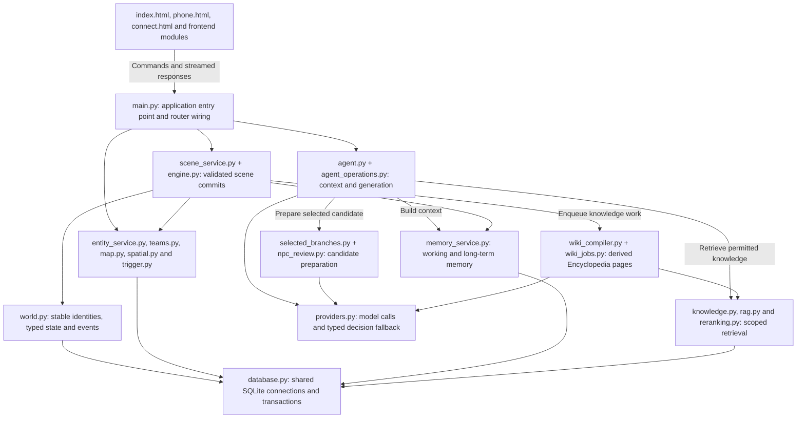

# Apertus Mundus - Track 2b

A persistent narrative roleplaying workbench built with Apertus. A game master can
explore candidate outcomes, expand a selected branch, and commit changes to a shared
world with teams, maps, character identities, scoped knowledge and versioned saves.

Team: Apertus Mundus.

## WHY APERTUS MUNDUS

Inspired by the Apertus open model, Apertus Mundus aims to make AI-driven
roleplaying a persistent world that a game master can run and shape. Player
choices have consequences beyond the next paragraph: characters remember events,
teams occupy real locations, and rules connect narrative decisions to world state.

The workbench brings scene authoring, branching simulation and session management
together. The GM explores possible outcomes and chooses what becomes part of the
story; confirmed changes carry forward through entities, maps, knowledge and saves.

The UI design draws inspiration from the
[official Hack Apertus website](https://hackapertus.ch/). Navy navigation, ivory
reading surfaces and red action accents bring technical clarity to a workbench
with the character of a narrative atlas.

## 💡 What It Can Do

- **Branching AI simulation:** Turn a player action into 2–4 candidate outcomes.
  Stream the selected branch's full narrative, then commit its HP/SAN, inventory,
  entity and map changes after preparation and expansion succeed.
- **Apertus generation and configurable decisions:** Use Apertus for narrative
  generation and NPC dialogue. Configure a separate decision provider and its
  fallback path in Model Settings, including smaller Apertus or local Kev decisions
  backed by the main Apertus service.
- **Three-level memory:** Combine a short-term workspace of up to 10 recent records
  within a context budget, entity profiles and memories, and retrievable long-term
  memory. Older working records are archived with summaries and their source text.
- **RAG and Encyclopedia:** Import worldbuilding and rule material, retrieve
  relevant passages during simulation, and maintain Encyclopedia entries with
  source revisions. Knowledge can be public, GM-only or scoped to a party.
- **NPC emotions and Persona:** Track trust, fear and irritation, configure
  breakpoint reactions, and give NPCs personality types, quirks and memories that
  inform their responses and conversations.
- **Spatial maps:** Connect rooms and passages to scenes, track party and entity
  locations, and use spatial context during simulation. Selected branches can
  discover or create locations and apply validated movement.
- **Triggers:** Combine `scene`, `item`, `stat` and `ai` conditions with `hard`
  navigation, `soft` prompts or `passive` effects to orchestrate story events.
- **Multiple team timelines:** Run parties in one shared world with separate
  scenes, locations and scoped memories, then merge timelines when their stories
  reconnect.
- **Further investigation:** Stream additional detail about the current scene
  through Investigate Further and retain it in the scene history used for reports.
- **Live updates and device access:** Push scene, investigation and BGM state over
  WebSocket, pair devices through the connection page, and synchronize saved world
  changes. The separate `phone.html` interface presents NPC contacts and dialogue
  as phone conversations.
- **Versioned saves and session reports:** Save world snapshots with characters,
  timelines, maps, memories, knowledge and existing embeddings. Generate incremental
  narrative reports from recorded scenes and download them as Markdown.

## Core Architecture (`src/`)

The application code lives in `track_2b/src/`. The frontend and Python modules below
form one narrative workbench: `main.py` assembles the FastAPI application, AI modules
prepare possible outcomes, and the world engine commits the chosen outcome. These
are logical responsibilities within the application, not separate backend services.



### Module Responsibilities

| Area | Main source modules | Responsibility |
| --- | --- | --- |
| Browser and API boundary | `index.html`, `phone.html`, `connect.html`, `frontend_api.js`, `frontend_sync.js` | GM interaction, NPC conversations, device access, HTTP requests, SSE consumption and revision-based refresh. |
| Application assembly | `main.py`, `config_api.py`, `device_link.py` | Initialize the world database, configure modules, mount routers, expose settings and handle device pairing and live player updates. |
| AI orchestration | `agent.py`, `agent_operations.py`, `inference_contracts.py`, `model_output.py` | Gather authoritative context, route actions, constrain candidate summaries and stream rendered prose. |
| Candidate preparation | `selected_branches.py`, `npc_review.py`, `map_review.py` | Prepare only the selected draft, resolve NPC identities and additions, and review proposed map changes before expansion. |
| Operation coordination | `summary_operations.py`, `expansion_operations.py` | Track request keys, cache completed results and lease in-flight work to avoid concurrent duplicate generation. |
| World commits | `scene_service.py`, `engine.py`, `world.py`, `database.py` | Validate branch effects and world versions, apply changes transactionally, maintain stable entity IDs and record confirmed events. |
| Domain rules | `entity_service.py`, `teams.py`, `map.py`, `spatial.py`, `map_effects.py`, `trigger.py` | Manage entities, party timelines, room topology, movement and trigger conditions and effects. |
| Memory and retrieval | `memory_service.py`, `knowledge.py`, `rag.py`, `reranking.py` | Maintain working and archived memories, enforce knowledge visibility, and retrieve and rerank relevant context. |
| Encyclopedia | `encyclopedia_api.py`, `wiki_compiler.py`, `wiki_jobs.py`, `wiki_service.py` | Edit source material, track revisions and provenance, and compile derived pages through background jobs. |
| Providers and saves | `providers.py`, `decision_contracts.py`, `runtime_config.py`, `campaigns.py` | Configure model access, validate typed decision formats, apply provider fallback, and save or restore world snapshots. |

`entity.py`, `timeline.py` and `memory.py` are compatibility entry points that
re-export the implementations in `entity_service.py`, `teams.py` and
`memory_service.py` respectively.

### Main Simulation Path

1. **Generate candidates:** `/api/ai/dynamic-options/stream` enters through
   `agent.py`. `agent_operations.py` builds scene, party, entity, spatial and scoped
   knowledge context, calls the model and validates 2–4 summaries. Candidate nodes
   and pending effects are saved as drafts; their proposed world effects are not
   applied.
2. **Prepare the selection:** `/api/ai/prepare-branch` delegates to
   `selected_branches.py`. NPC and spatial review resolve the chosen draft against
   the current world, with GM input when required.
3. **Expand the narrative:** `/api/ai/expand-branch/stream` streams prose through
   `agent_operations.py` and `model_output.py`. `expansion_operations.py` coordinates
   the request. The result is saved on the draft without committing world events,
   memories or trigger effects.
4. **Commit the outcome:** `/api/game/commit-scene` enters `scene_service.py` and
   delegates generated branches to `engine.py`. A transaction applies validated
   effects through the world and domain modules, records the event and updates
   memories and scene history. Request keys and world-state checks prevent repeated
   or stale application; memory maintenance and Encyclopedia compilation follow
   confirmed changes.

## ✨ How to Use

### 1. Load a Campaign

Start the application using the [quick start instructions](#quick-start), then open
http://localhost:8000/index.html. Choose an entry under **Campaigns and Saves** and
click **Load Campaign and Start**. **Model Settings** lets you configure and test
the saved generation, decision and retrieval connections.

The included examples provide different starting points:

- **Mist Harbor Lighthouse - Public Demo:** A fictional lighthouse investigation.
- **Blank Campaign:** An opening scene for authoring your own world.
- **Limmat — The Forbidden River:** A hidden-world student adventure in Zurich
  with two teams, authored rules, maps and reference material.

Use these as demonstrations or starting points for your own campaigns.

### 2. Run a Simulation

Select a scene from **Scene Directory** or **Node Graph**. Under **Player Actions &
Dynamic Simulation**, describe the player's action and click **Run Simulation**.
The AI generates 2–4 candidate summaries whose proposed consequences can include
HP/SAN changes, items gained or lost, movement, and new characters or entities.

Choose a branch to continue. The workbench prepares that candidate, asks for NPC
review when needed, and streams its expanded narrative. After expansion succeeds,
it commits the selected scene and its world changes together. Generating candidate
summaries alone does not apply their proposed consequences. If a request needs
clarification, resolve it before continuing.

### 3. Manage World Resources

Use the workbench's task groups to keep the session and its reference material
connected:

- **Session Host:** Open **Timeline** to create parties, assign their scenes and
  members, run independent simulations, inspect their memories or merge timelines.
  Open **Map** to edit rooms and passages and inspect party and entity positions.
- **World Information:** Use **Entities** for the world entity registry,
  **Encyclopedia** for source material and compiled knowledge, **Memory Stream**
  for session history, and **World Settings** for the campaign's foundation.
- **Rule Orchestration:** Configure **Triggers**, or use **Edit Scenes and
  Branches** to author scenes and their choices.

Click **Investigate Further** on a scene to expand its details. Use **Connect
Device** to open the connection page and, when LAN access is enabled, pair a phone
using a QR link. Choose the responsive GM workbench or the separate NPC
communication interface. Connected workbenches share saved world changes; local
drafts remain on their device.

### 4. Save and Resume

Under **Session Host**, click **Save Game**. Choose **Overwrite Current Save**
when a save is active, or **Create New Save** and enter a name for a separate
snapshot. To resume, select that save under **Campaigns and Saves** on the launch
screen and load it.

Saves are stored as `campaigns/<save-name>/campaign.json` under the configured
campaigns directory. The versioned snapshot includes scenes, characters, entities,
timelines, maps, triggers, memories, knowledge records and existing embeddings.
Loading restores this state and refreshes the retrieval cache. Rebuild embeddings
if you change the embedding model.

### 5. Generate a Session Report

Under **Session Host**, open **Session Report** and click **Generate Epic Session
Report**. The engine turns recorded scene snapshots, player actions and further
investigation details into a Markdown narrative chapter. Review the result, then
click **Download Markdown Document**.

Reports normally cover new scene records since the previous successful generation.
When there are no new records, the interface offers regeneration. Each generated
report is also written to the server's configured reports directory (`battle_report/`
by default). These Markdown files are stored separately from game saves.

## Quick start

Requirements: Docker Engine 28+, Docker Compose 2.24+, GNU Make, NVIDIA Container
Toolkit and a compatible NVIDIA GPU with sufficient VRAM for Apertus v1.5 8B.
**Hugging Face access must already be granted** to the account downloading
[Apertus v1.5 8B](https://huggingface.co/swiss-ai/Apertus-v1.5-8B). Accept the model's
access conditions on that page first, then run `hf auth login` on the host using
a read token from the same account. Skip CLI login if already authenticated.
Creating an account or logging into the browser alone does not grant model access
or provide Docker download credentials. Never commit the token to GitHub.

```sh
make run
```

Open http://localhost:8000/index.html once startup completes. No `.env.docker` or
inference API key is required. The default command prepares pinned Apertus weights,
starts its local GPU server and the three CPU helpers, and waits for their health
checks before starting the application. Downloads reuse the host Hugging Face login;
later starts reuse the model cache. Initial builds download Apertus weights plus
approximately 12.72 GB of helper weights and dependencies. The helpers alone have
32 GB Docker RAM and 40 GB disk planning allowances; add capacity for Apertus and
its serving image. Hardware minima and full-stack latency have not been measured.
`make stop` preserves the saved world. `make smoke` checks isolated mocked inference;
`make smoke-live` exercises the configured real services.

The application stays in `track_2b/`, following the
[official template](https://github.com/HackApertus/project-template/blob/main/track_2b/README.md).
The root Makefile forwards commands to that directory.

## Architecture and scope

The default architecture is self-managed on-premise: `make run` (also available
as `make run-local`) serves Apertus v1.5 8B locally. `make prepare-model` optionally
prepares weights in advance. `make run-remote` retains external Apertus endpoint
support through `LLM_NAME`, `LLM_BASE_URL` and `LLM_API_KEY`, supplied by the operator.
Local supporting models provide embeddings, reranking and typed decisions. Build
preparation requires network access. This is an on-premise deployment, not a
validated air-gapped release: the frontend still requests Google Fonts, CDN icons
and optional online background music. Fully disconnected operation has not been validated.

The interface, bundled fictional scenarios and project documentation are in English.
Data includes the original CC0 lighthouse demo, an adaptation of the supplied Limmat
story and a blank starter. It stays below 100 MB; credentials and production saves
are excluded.

## Documentation and submission status

- [Application README](track_2b/README.md)
- [Deployment guide](track_2b/docs/DOCKER.md)
- [English example and blank campaign](track_2b/data/scenarios/README.md)
- [Technical report source](track_2b/technical_report.md)
- [Technical report PDF](track_2b/Apertus_Mundus_Report.pdf)

Compose configuration, root command forwarding and the offline application smoke
flow pass. Full concurrent real-model deployment still requires target-hardware
validation. The required demo video has not yet been recorded.

Source code: [Apache-2.0](LICENSE). Model weights retain their upstream licences.
